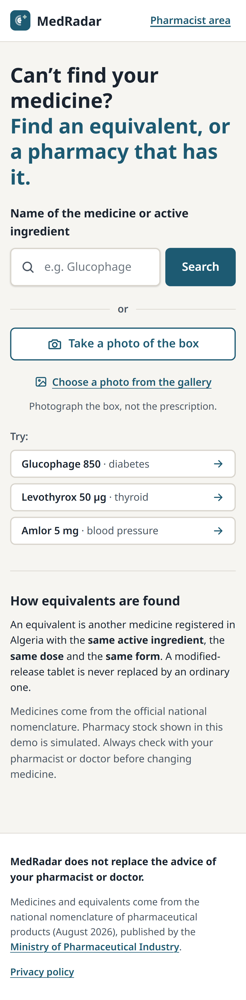
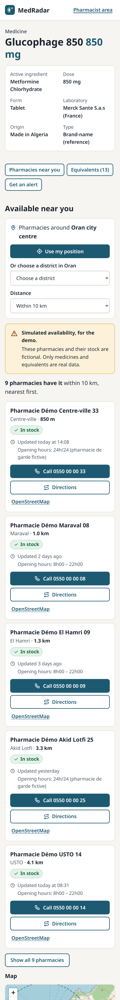

# Quality audit report — MedRadar

Audit of 27 October 2026, branch `fix/qa-audit` (from `main` at commit `04a546c`, after PR #5 was merged).

> **Update since the audit.** The 4 major issues below were handled afterwards: email alerts are sent (PR #7), PostgreSQL is supported and tested (PR #8, then the deployment work in PR #10), the demo has an empty approved account and is reset every night (PR #9 and PR #10), and production uses `gemini-3.5-flash-lite`, which has a much larger free quota (`render.yaml`, PR #10). This report is kept as it was written on the day of the audit.

## Verdict: NOT READY YET

No **blocking** issue. The jury journey (search a medicine, see its equivalents and the map, log in as a pharmacist and change a stock) works on desktop and on mobile, without errors.

**4 major issues** remain. Each one needs a decision from the project owner, because it concerns the product or the deployment:

1. **Email alerts are never sent.** The alert is saved and the patient reads "We will email you…", but there is no email service in the code.
2. **Demo accounts are shared and can be changed.** A judge who changes the address of the demo pharmacy sends it back "to verification": the next judge can no longer change a stock. The password can also be changed through the API.
3. **Gemini quota.** The box photo and the delivery note scan use `gemini-3.8-flash`, whose free plan only allows 20 requests a day, with no fallback model when the quota is exceeded (429).
4. **The production PostgreSQL database was never tested.** Its driver (`psycopg`) is not in `requirements.txt`: the API would not start with a PostgreSQL `DATABASE_URL`.

Details and recommendations are in the "Remaining issues" section.

## Test results (after the fixes)

| Check | Result |
| --- | --- |
| Backend tests (`python -m pytest`) | **197 passed**. Only warning: a deprecation inside Starlette, the library, not in the project's code |
| End-to-end tests (`npm run test:e2e`, desktop and mobile) | **52 passed**, including 4 new regression tests |
| `npm run lint` | 0 errors, 0 warnings |
| `npx tsc --noEmit` | OK |
| `npm run build` | OK, no warnings |
| axe-core (WCAG 2.1 A and AA), 16 pages × 2 devices | **0 violations**, all severities |
| `scripts/check_equivalents.py` (10 brands) | **Identical** to `docs/verification_equivalents.md` (161 equivalents) |
| Secrets in the repository and in the whole git history | **None** (details below) |

### Lighthouse (mobile, local production build)

| Page | Performance | Accessibility | Best practices | SEO |
| --- | --- | --- | --- | --- |
| Home | 79 to 85 | 100 | 100 | 100 |
| Medicine page (GLUCOPHAGE 850), before the fix | 47 | 97 | 100 | 91 |
| Medicine page, after the fix | **64** | 97 | 100 | 91 |

- On the medicine page, the layout shift (CLS) goes from 0.339 to **0**.
- What remains:
  - JavaScript time (TBT about 800 ms), due to the Leaflet map and Next.js;
  - map markers too close together for a finger: the list of pharmacies, just above, offers the same actions;
  - a "meta description" that Lighthouse does not see. It exists, but Next 16 streams it after the `<head>`.
- Measured locally, without a real mobile network. Scores vary by ±5 points between runs.

## Fixes made

| # | Commit | Issue | Severity |
| --- | --- | --- | --- |
| 1 | `b1e1dff` | **Map crash with the browser Back button.** Scenario: medicine page → click on an equivalent → Back, and the page showed "Something went wrong". Next 16 keeps visited pages in memory, and the Leaflet map was reused after it had been destroyed. It also affected the maps of the registration, "Edit my pharmacy" and admin pages. E2e test added | Major |
| 2 | `7ec31bb` | **Empty map for a visitor outside Oran.** A judge in Algiers or in France who shared their position saw "No pharmacy within 10 km" and an empty map. If the permission was already granted, it even happened without a click. The page now stays on Oran city centre and explains why. E2e test added | Major |
| 3 | `4f1133e` | A search longer than 100 characters showed "Something went wrong". The field is now limited to 100 characters, like the API, and a longer link is shortened | Minor |
| 4 | `b754151` | When the API could not be reached, the scanner page told an approved pharmacy "Available once your pharmacy is approved". It now shows the connection error, with "Try again" | Minor |
| 5 | `9b1b27c` | The footer jumped while the medicine page loaded (Lighthouse: CLS 0.34 → 0) | Minor |
| 6 | `41bebd0` | The placeholder of the search field was cut on phones ("Medicine name (Fr") | Minor |
| 7 | `25bed4d` | README: setup from scratch (details below) | Major for a developer or a judge |
| 8 | `abdc307` | `.env.example`: optional variables not described | Minor |

## Remaining issues

### Major (to decide before going online)

| Issue | What happens | Recommendation |
| --- | --- | --- |
| Email alerts not sent | `POST /alerts` saves the alert. The message says "Alerte enregistrée. Vous serez prévenu(e) par email" and the screen says "We will email …", but nothing is ever sent: there is no email service and no sending task (`EMAIL_API_KEY` is read nowhere). | Either implement sending, which is a **new feature** for its own branch, or, for the defence, change the text to "Alert saved. Email sending will be added soon" and say so in "Not finished yet". Not changed during the audit: it is a product choice. |
| Demo accounts editable by anyone | With `pharmacien1` or `pharmacien2`, "Edit my pharmacy" lets you change the address: the pharmacy goes back to "being verified", and the next judge can no longer declare stock. Checked during the audit. `POST /auth/change-password` also lets you change the password. | At least, run `python scripts/generate_demo_data.py` again just before the defence and give `pharmacien1` to the jury. Better: forbid these two changes for `@medradar.demo` accounts (a small API change, to be approved). |
| Gemini quota of 20 a day | Box photo and note scan use `gemini-3.8-flash` (20 requests a day on the free plan). The fallback model is only tried on a 503 error, not when the quota is exceeded (429). During the audit, 4 real readings succeeded (scan: 11 and 24 s; photo: 28 s). | Set `LLM_MODEL=gemini-3.5-flash-lite` on the production server, or also try the fallback model on a 429 error. To check: the scan evaluation (100 %) was made with 3.8-flash. |
| PostgreSQL not tested | The README and `.env.example` announce PostgreSQL in production, but `psycopg` is in no `requirements.txt` and nothing was tested on PostgreSQL (migrations, search). | Add `psycopg[binary]` to the dependencies and run `alembic upgrade head` then the tests on a real PostgreSQL database, or deploy with SQLite on a persistent disk. The information was added to the README, without changing the dependencies. |

### Minor

| Issue | Recommendation |
| --- | --- |
| The dose is repeated in titles when the official name already contains it: "Glucophage 850 850 mg" | Do not add the dose when the name already ends with that number. This touches 8 components, so it was not done. |
| Typing "gluco", the 8 suggestions do not include GLUCOPHAGE (alphabetical order: Glucobay, Glucoformine…). It appears from "glucop", and the validated search puts it first | Rank the best-known names first, if wanted |
| `/admin` without a login redirects to "Pharmacist login", with "Register your pharmacy" | Add a sentence "Admin? Log in here too", or a neutral title |
| Without a Gemini key, the "Scan a note" tab stays in the pharmacist menu. The page then explains that the scan is not available | Acceptable |
| The page of an unknown medicine makes 3 requests that fail with 404 (visible in the console), but the message on screen is clear | Acceptable |
| The CSV exported without a filter is named `medradar-delivery-notes-start-today.csv` | Cosmetic |
| The limit of 5 logins a minute is counted per IP address: a whole jury on the same Wi-Fi who make several mistakes waits a minute | Acceptable, and the message is clear: "Too many attempts. Please try again in a minute." |

## Table of all checks

Result: **OK**, **fixed** (with the fix number), or **remaining issue**. Severity: only for what was not OK.

### 1. Setup from scratch

| Feature | Step | Result | Severity |
| --- | --- | --- | --- |
| Clone | `git clone` from GitHub into an empty folder | Fixed (7): the README URL was `<your-username>` | Minor |
| Requirements | Python and Node versions | Fixed (7): missing, added (Python 3.12, Node 20, tested) | Minor |
| Data | `clean_nomenclature.py`, then `check_equivalents.py` | OK: the CSV produced is identical to the one in the repository, the official file is not modified | — |
| `.env` | `cp .env.example .env` and `JWT_SECRET` | OK | — |
| Backend | `pip install`, `alembic upgrade head` (4 migrations), `create_admin.py`, `generate_demo_data.py` | OK, in a fresh Python environment | — |
| Demo accounts | Which logins to use? | Fixed (7): the README did not give them (emails, password, which pharmacy is approved or pending, where the admin logs in) | Major |
| API | `uvicorn`, `/health`, `/medicines/search?q=glucofage` | OK | — |
| Frontend | `npm install` (0 vulnerabilities), `.env.local`, `npm run dev` | OK | — |
| README | Tech stack | Fixed (7): "PostgreSQL (pg_trgm)" was wrong (SQLite in development, in-memory search with RapidFuzz), and the AI row only mentioned the photo | Minor |
| README | Tables of routes and pages | Fixed (7): `/features` also returns `delivery_scan`, the `/pharmacien/pharmacie` page was missing | Minor |
| `.env.example` | Every variable of the code is there, no real value | OK. Fixed (8): `MEDICINES_CSV` was missing (optional), the key comment only mentioned the photo, and `EMAIL_API_KEY` is now marked "not read by the code yet" | Minor |
| PostgreSQL | Driver installed? | Remaining issue: `psycopg` missing. Information added to the README | Major |

### 2. Quality and secrets

| Feature | Step | Result | Severity |
| --- | --- | --- | --- |
| Backend tests | `pytest` | OK: 197 passed | — |
| E2e tests | `npm run test:e2e` | OK: 52 passed | — |
| Lint, TypeScript, build | `npm run lint`, `tsc`, `npm run build` | OK, no warnings | — |
| Secrets | Keys (`AIza…`, `sk-…`, `ghp_…`, private keys) in the whole history (`git log --all -p`) | OK: none | — |
| Secrets | `.env`, `.db`, `.pem` or `.key` files ever committed | OK: only `.env.example` and `frontend/.env.example` | — |
| Secrets | Passwords in the code | OK: only test values (`Admin2026x` in `backend/tests/conftest.py`, `E2eDemo2026` in `frontend/e2e/config.ts`), used on temporary databases. The real passwords of the `.env` are different, and `JWT_SECRET` is 64 characters long | — |
| Secrets | `.env`, `*.db` and `.env.local` ignored by git | OK | — |

### 3. Patient journey

| Feature | Step | Result | Severity |
| --- | --- | --- | --- |
| Home | Texts, field, Search button, "or", photo button | OK | — |
| Home | Suggestions while typing, arrow keys and Enter | OK | — |
| Home | "Try" examples (Glucophage 850, Levothyrox 50 µg, Amlor 5 mg) | OK: they open the right page | — |
| Home | Demo notice | OK: "Pharmacy stock shown in this demo is simulated" (home), and a "Simulated availability" box on each medicine page | — |
| Home | Footer: ministry link (200) and privacy (200) | OK | — |
| Home | Placeholder cut on mobile | Fixed (6) | Minor |
| Search | "GLUCOPHAGE", "glucofage", "levotirox", "metformine" | OK: the right medicine first | — |
| Search | Empty field, 1 character | OK: "Type the name of a medicine — At least 2 letters" | — |
| Search | `%%%'"<script>` | OK: shown as text, "No medicine found" | — |
| Search | 150-character text | Fixed (3) | Minor |
| Search | Unknown name "zzzqqqwww" | OK: "No medicine found for … Try the name written on the box, or take a photo" | — |
| Multilingual | "غلوكوفاج", "dwa ta3 glucophage" | OK: "we understood: GLUCOPHAGE" (Gemini in 0.9 s and 1.5 s) | — |
| Multilingual | "metformin" | OK: METFORMINE (1.6 s) | — |
| Multilingual | "دوا السكر", "medicine for diabetes" | OK: refused by our rules, without calling Gemini, with a clear message | — |
| Multilingual | Right-to-left Arabic | OK: the field switches to `rtl` (`dir="auto"`), the quoted text is in `<bdi lang="ar" dir="auto">` | — |
| Photo | Button shown with the key, hidden without it (from `/features`) | OK | — |
| Photo | Box (test image), with the real Gemini | OK: "We read: GLUCOPHAGE 850 mg", 3 proposals, "Exact match" (28 s) | — |
| Photo | Fictional prescription | OK: "This looks like a prescription", nothing is searched | — |
| Photo | PDF file; 12 MB file | OK: "This file is not a photo we can read"; "This photo is too large" | — |
| Medicine page | Details (molecule, dose, form, laboratory, origin, type) | OK | — |
| Medicine page | Equivalents and caution message | OK: GLUCOPHAGE 850 has 13 equivalents, and "Ask your pharmacist or doctor first" | — |
| Medicine page | Dose not checked | OK: "Dose not checked automatically" (e.g. Neo-Codion Nourrissons) | — |
| Medicine page | No equivalent (DIAMICRON 60 mg LM) | OK: "No equivalent registered … Talk to your doctor" | — |
| Medicine page | Dose repeated in the title | Remaining issue | Minor |
| Map | Geolocation accepted, in Oran | OK: "Pharmacies around your position", increasing distances (2.1 / 3.0 / 4.7 / 6.0 / 7.7 km) | — |
| Map | Geolocation accepted, outside Oran | Fixed (2) | Major |
| Map | Geolocation refused | OK: "You did not share your position. We show pharmacies around Oran city centre" | — |
| Map | Choosing a district (USTO) | OK: the nearest pharmacy is 480 m away | — |
| Map | Radius (3 km) | OK: "1 pharmacy has it within 3 km" | — |
| Map | Colours and legend | OK: in stock, out of stock, no information, your position | — |
| Map | "To be confirmed" notice | OK: "To be confirmed by phone" after 7 days (tested through the API and the e2e tests) | — |
| Map | "Call" and "Directions" | OK: `tel:0550000021`, Google Maps with a destination, OpenStreetMap with a route | — |
| Map | Back button, then Forward | Fixed (1) | Major |
| Alert | Invalid email | OK: blocked before sending ("Enter a valid email address") | — |
| Alert | Valid email, with a double click | OK: a single request, "Your alert is saved" | — |
| Alert | Limit of 5 | OK: "You already have 5 alerts with this email" | — |
| Alert | Sending the email | Remaining issue: never sent | Major |
| Privacy | `/confidentialite` page | OK, including the photo and the delivery notes | — |
| Navigation | Back from a medicine page to the search | OK: the query and the results are kept | — |
| Navigation | Reloading the search, privacy, login, registration and a medicine page | OK | — |
| Navigation | Direct link to a medicine page | OK | — |
| Navigation | 404 page (`/nimportequoi`); unknown medicine | OK: "Page not found"; "Medicine not found" | — |
| Console | JavaScript errors or failed requests on the 17 public pages | OK: only the intended 404s | — |
| Layout | Horizontal scrolling or cut text, at 1280 px and on Pixel 7 | OK: none | — |

### 4. Pharmacist journey

| Feature | Step | Result | Severity |
| --- | --- | --- | --- |
| Registration | The 2 steps and the map to place the pharmacy | OK (covered by the e2e tests and the screenshots) | — |
| Registration | Email already taken (409), weak password, invalid phone (personal and pharmacy), empty field | OK: a clear message for each rule | — |
| Registration | Final "pending" message | OK: "Your pharmacy is waiting for verification" | — |
| Login | Wrong password and unknown email | OK: the same message, "Incorrect email or password." | — |
| Login | Empty fields | OK: "Enter your email and your password." | — |
| Login | Attempt limit | OK: 429 after 5 a minute, "Too many attempts…" | — |
| Login | Logout, then `/pharmacien` | OK: back to the login page | — |
| Login | Expired token (refused by the API) and token expiring while the page is open | OK: clean return, "Your session has ended. Please log in again." | — |
| Login | Forged admin token | OK: 401 | — |
| Pending | Login possible | OK: "Your pharmacy is being verified" | — |
| Pending | Declare stock, scan a note | OK: 403 "Votre pharmacie est en cours de vérification", and the scanner shows "Available once approved" | — |
| Dashboard | "In stock" and "Out of stock" on 3 medicines | OK: visual feedback in 73 to 87 ms, and "Saved: …" | — |
| Dashboard | Double click | OK: a single request | — |
| Dashboard | "Update first" order | OK: never updated first, then oldest to newest. A medicine just updated moves to the end of the list on reload | — |
| Dashboard | Add a followed medicine, then stop following it (with confirmation) | OK | — |
| Edit | Invalid phone; valid phone and opening hours | OK: error message; "Changes saved" | — |
| Edit | Address change | OK: the pharmacy goes back to "Being verified" | — |
| Edit | Shared demo accounts | Remaining issue | Major |
| Patient | A declared stock appears on the medicine page and the map | OK: through the API (newly approved pharmacy) and in the browser | — |
| Note scan | Demo note, with the real Gemini | OK: 20 lines read (15 recognised, 1 to check, 2 not delivered, 1 off the list), in 11 s | — |
| Note scan | Correcting a line (TAHOR, choosing the dose) | OK: "Corrected by you" | — |
| Note scan | Back orders | OK: "Not delivered (2)", never put in stock | — |
| Note scan | Confirmation with a double click | OK: a single confirmation, "Stock updated" | — |
| History | Photo kept, then deleted | OK | — |
| History | No price shown | OK | — |
| History | "When did I receive… ?" | OK | — |
| History | CSV export | OK: ";" separator, BOM, 9 columns without prices | — |
| History | Cancelling within 24 h | OK: "Note cancelled" | — |
| History | Deleting the note | OK | — |
| History | Without history | OK: the photo box is disabled, "15 medicines updated", nothing is kept | — |
| Security | Pharmacy 2 on a note of pharmacy 1 (read, photo, edit, delete, cancel) | OK: 404 "Bon introuvable" | — |
| Security | `pharmacie_id` or `id` added to the request | OK: 422, field refused | — |
| Security | Pharmacist on `/admin` and on the admin API | OK: "This page is for administrators only" page, and 403 | — |
| Security | Admin on a note | OK: 403 | — |

### 5. Admin journey

| Feature | Step | Result | Severity |
| --- | --- | --- | --- |
| Login | Admin, then redirect to `/admin` | OK | — |
| Login | "Pharmacist login" title for the admin | Remaining issue | Minor |
| List | Pending, approved, rejected or suspended | OK | — |
| Validation | Approve | OK: the pharmacy appears in `/pharmacies` and on the medicine page | — |
| Validation | Reject without a reason | OK: 422, reason required | — |
| Validation | Suspend | OK: the pharmacy disappears from `/pharmacies` and from the map | — |
| Access | Without a token; with a pharmacist token | OK: 401; 403 | — |

### 6. Robustness

| Feature | Step | Result | Severity |
| --- | --- | --- | --- |
| API stopped | Home, search, suggestions, medicine page, dashboard, history, login | OK: "We can't reach MedRadar right now. Check your internet connection and try again.", never a blank page | — |
| API stopped | Scanner page | Fixed (4) | Minor |
| Without `LLM_API_KEY` | `/features` | OK: everything is `false` | — |
| Without `LLM_API_KEY` | Home | OK: the photo button is hidden | — |
| Without `LLM_API_KEY` | Scanner | OK: "Reading delivery notes is not available" | — |
| Without `LLM_API_KEY` | `/medicines/recognize` | OK: 503 with a clear message | — |
| Without `LLM_API_KEY` | Arabic and Darija search | OK: by the rules, in 130 ms | — |
| Without `LLM_API_KEY` | Stock declaration and history | OK | — |
| Slow API (+3 s) | Loading indicators | OK: "Loading the medicine…", "Searching…", "Broader search…", "Saving…", "Logging in…", "Loading your pharmacy…", "Reading the note…" | — |
| Slow API (+3 s) | Buttons while sending | OK: disabled | — |
| Double click | Alert, declaration, note confirmation | OK: no action done twice | — |
| Gemini quota | Photo and scan | Remaining issue | Major |

### 7. Accessibility and performance

| Feature | Step | Result | Severity |
| --- | --- | --- | --- |
| axe-core | Home, 3 searches, medicine page, page without equivalent, 404, privacy, login, registration (and its errors), dashboard, edit, scanner, history, note detail, admin, on desktop and mobile | OK: 0 violations | — |
| Keyboard | Home | OK: skip link, field, Search, photo, examples, footer; focus always visible | — |
| Keyboard | Medicine page | OK: keyboard choice (arrows and Enter), anchors, "Use my position", district, distance, "Call", "Directions", equivalents, alert; focus visible | — |
| Keyboard | Dashboard | OK: menu, edit, logout, scan, add, "In stock", "Out of stock" and Enter | — |
| Lighthouse | Home | OK: 79 to 85 in performance, 100 elsewhere | — |
| Lighthouse | Medicine page | Fixed (5): CLS 0.34 → 0, performance 47 → 64. TBT and marker size: remaining issue | Minor |
| Arabic | Right-to-left display | OK | — |

### 8. Data accuracy

| Feature | Step | Result | Severity |
| --- | --- | --- | --- |
| Reference | GLUCOPHAGE 850 | OK: 13 equivalents | — |
| Reference | DIAMICRON 60 mg LM | OK: 0 (and 4 for DIAMICRON 30 mg LM) | — |
| Reference | AMLOR 10 mg | OK: 8 equivalents, all "AMLODIPINE SOUS FORME BESYLATE" (AMLOCARDINE, DIMLOR, LOTENSE…) | — |
| Exclusion | 1,039 hospital-only or withdrawn medicines | OK: 400 ids tested, all 404; 200 names searched, never in the results | — |
| Version | Nomenclature | OK: "August 2026" in the footer and in the README | — |
| Equivalents | `check_equivalents.py` on the 10 brands of the document | OK: no change compared to `docs/verification_equivalents.md` | — |

### 9. Jury simulation

| Step | Result | Severity |
| --- | --- | --- |
| Arriving from the link, understanding the site | OK: the title states the problem, "Try: Glucophage 850 · diabetes" offers a concrete example, and the demo is announced as simulated | — |
| Searching an out-of-stock medicine | OK: type the name and pick a suggestion, or click the example | — |
| Seeing the equivalents and the map | OK: anchor links "Pharmacies near you" and "Equivalents (13)", map with a legend | — |
| Judge outside Oran who shares their position | Fixed (2): they saw an empty map | Major |
| Finding the pharmacist area | OK: "Pharmacist area" link at the top of every page | — |
| Logging in and changing a stock | OK: large "In stock" and "Out of stock" buttons, and "Saved: …" | — |
| Duration | OK: 4 screens, 4.5 s at robot speed, about 1 to 2 minutes for a person (on mobile, you scroll below the "Scan a delivery note" block) | — |
| Next judge, if a judge changed the demo pharmacy | Remaining issue | Major |

## Method

- **Setup.** Fresh clone from GitHub into a temporary folder, with a fresh Python environment, following only the README.
- **Audit environment.**
  - The API of the working copy ran on a separate database, created by the README scripts: the development database was not touched.
  - The real Gemini key was used, except for the "without a key" test.
  - The frontend ran as a production build (`npm run build` then `next start`).
- **Browser tests.** Temporary Playwright scripts, on desktop (Chrome) and mobile (Pixel 7). They recorded console errors, failed requests, horizontal scrolling and cut text. They were not committed.
- **Real Gemini calls** during the audit: 2 photos, 2 notes and a few searches.

## Screenshots

They are in [docs/qa_screenshots/](qa_screenshots/) and were taken on the fixed version.
- For each main page: `desktop-*.png` and `mobile-*.png` (home, searches, medicine page, page without equivalent, 404, privacy, login, registration, dashboard, pharmacy edit, scanner, history, note detail, admin).
- The steps of the jury simulation: `judge-*.png`.
- Very long pages are cut at 9,000 pixels.

| Home (mobile) | Medicine page (mobile) |
| --- | --- |
|  |  |
